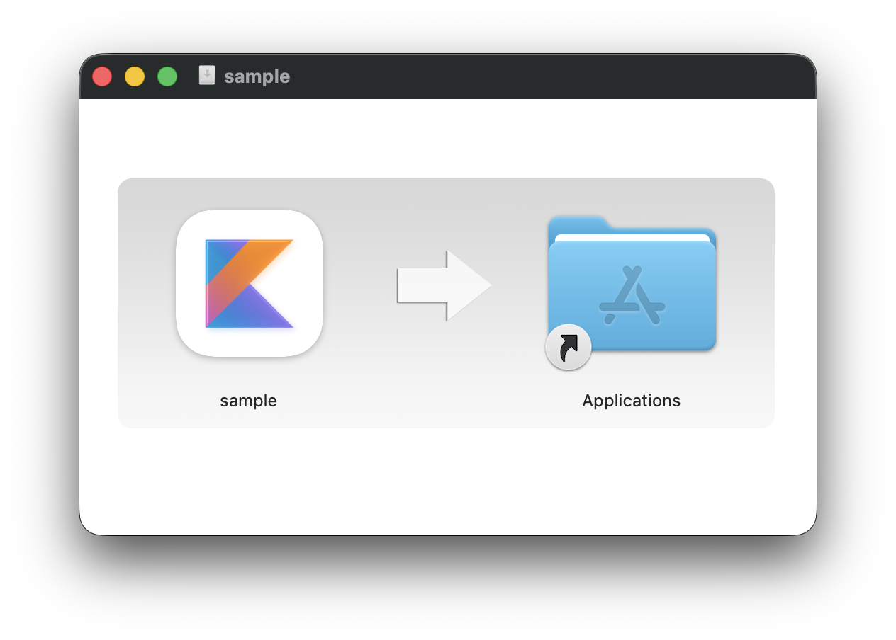
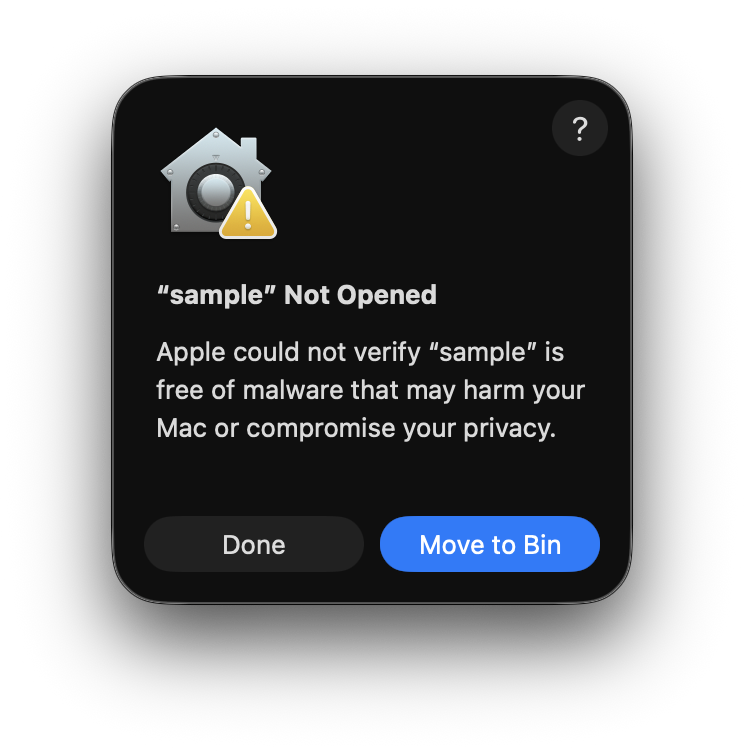
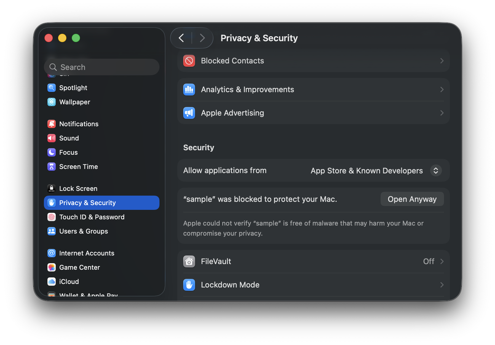
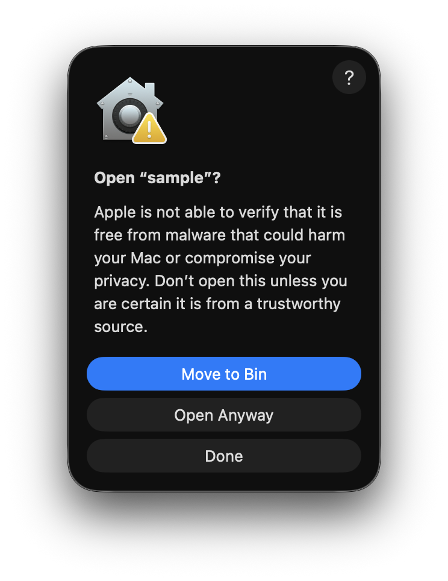
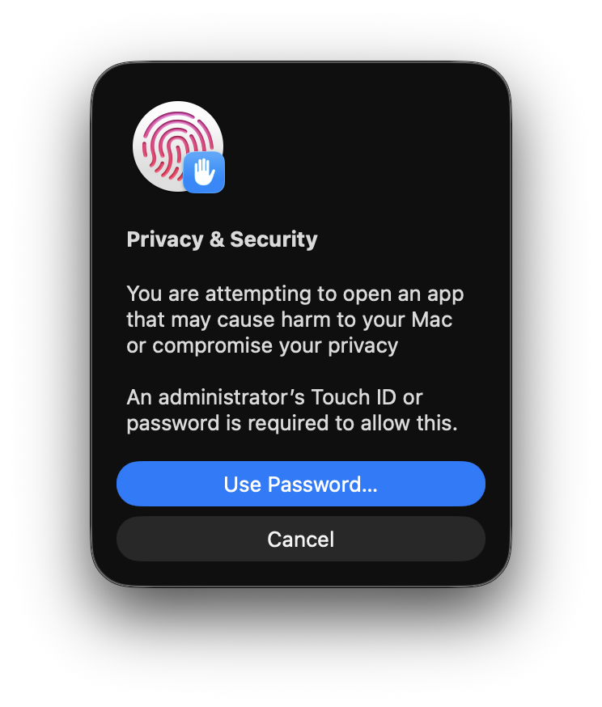
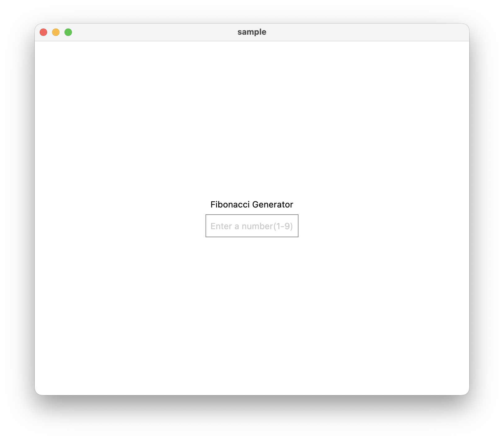
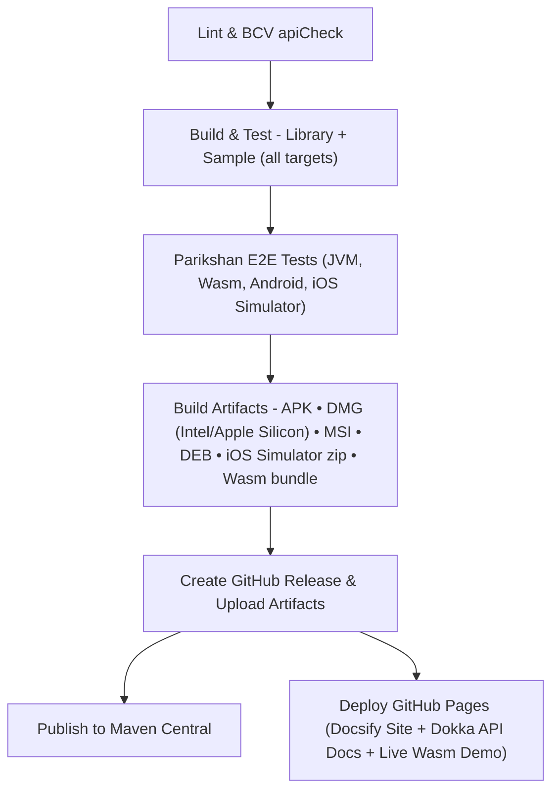

<h1 align="center">Compose Multiplatform Library Template</h1>

<p align="center">
  
  
</p>

<p align="center">
  <a href="https://github.com/aryapreetam/cmp-lib-template/actions/workflows/release.yml">
    
  </a>
  <a href="https://mvnrepository.com/artifact/io.github.aryapreetam/fiblib">
    
  </a>
  <a href="https://github.com/aryapreetam/cmp-lib-template/blob/main/LICENSE">
    
  </a>
</p>

<p align="center">
  
  
  
  
</p>

<!-- New: Brief template description -->
This repository is a ready-to-ship template for building and releasing Compose Multiplatform libraries. It automates the heavy lifting so you can focus on your API and UX:

- Turns your README into a library homepage and publishes it via GitHub Pages (rendered using Docsify).
- Builds and deploys a wasm demo to `/demo` so users can try your library in the browser.
- Generates and publishes API docs (Dokka) to `/api`.
- Produces downloadable sample app executables (APK, DMG, iOS Simulator zip, wasm bundle) so users can validate the library on their device/emulator quickly.
- Wires a complete CI/CD: test → package → GitHub Release → Pages deploy → optional Maven Central publish on tags.

Wasm Demo: 
[](https://aryapreetam.github.io/cmp-lib-template/demo/)

API Docs:
[](https://aryapreetam.github.io/cmp-lib-template/api/)

---

https://github.com/user-attachments/assets/b574fc22-eff4-452e-adf6-02ba54b6bbd3

## 🛠️ Using This Template

**New to this template?** Check out the complete guide: [📖 Using This Template for Your Library](docs/using-this-template.md)

**Quick setup:**
1. Click "Use this template" to create your repo
2. Follow the [setup guide](docs/using-this-template.md) to customize for your library
3. Configure [GitHub secrets](docs/github-secrets-setup.md) for publishing
4. **Enable GitHub Pages:** Go to repository Settings → Pages → Source: Select "GitHub Actions"
5. Start coding your library!

> **Note:** You don't need a pre-existing `<username>.github.io` site. GitHub Pages will automatically create `https://<username>.github.io/<your-library-name>/` when you run your first release.

**For contributors:** See [CONTRIBUTING.md](CONTRIBUTING.md) for development guidelines.

---

## 📦 Download Sample App Executables

Download and try the sample app on your platform without building from source:

| Platform | Download Link |
|----------|--------------|
| 🍏 **macOS (Intel)** | [](https://github.com/aryapreetam/cmp-lib-template/releases/latest/download/sample-app-desktop-x64.dmg) |
| 🍎 **macOS (Apple Silicon)** | [](https://github.com/aryapreetam/cmp-lib-template/releases/latest/download/sample-app-desktop-arm64.dmg) |
| 🪟 **Windows** | [](https://github.com/aryapreetam/cmp-lib-template/releases/latest/download/sample-app-windows.msi) |
| 🐧 **Linux** | [](https://github.com/aryapreetam/cmp-lib-template/releases/latest/download/sample-app-linux.deb) |
| 🤖 **Android** | [](https://github.com/aryapreetam/cmp-lib-template/releases/latest/download/sample-app-android-unsigned.apk) |
| 🌐 **Web (Wasm)** | [](https://github.com/aryapreetam/cmp-lib-template/releases/latest/download/sample-app-wasm.zip) |
|  **iOS Simulator** | [](https://github.com/aryapreetam/cmp-lib-template/releases/latest/download/sample-app-ios-simulator.zip) |

### How to Run the Sample App

#### 🤖 Android
**Option 1: Drag and Drop**
- Download the APK file
- Open an Android emulator or connect a physical device
- Drag the APK onto the emulator window

**Option 2: ADB Install**
```bash
adb install sample-app-android-unsigned.apk
```

#### 🌐 Web (Wasm)
- Download and unzip `sample-app-wasm.zip`
- Open `index.html` in a web browser

**Note:** You can also try the live demo without downloading: [Try Live Demo](https://aryapreetam.github.io/cmp-lib-template/demo/)

#### 🍏 iOS Simulator
- Download `sample-app-ios-simulator.zip` from the [latest release](https://github.com/aryapreetam/cmp-lib-template/releases)
- Unzip to get `sample-app-ios-simulator.app`
- Open your iOS Simulator in Xcode
- Drag the `.app` onto the Simulator window OR run:
  ```sh
  xcrun simctl install booted /path/to/sample-app-ios-simulator.app
  ```
- The sample app will now appear and can be launched directly from the Simulator!

#### 🍎 macOS
- Download the DMG for your Mac architecture (Intel or Apple Silicon)
- **When you open the app for the first time, macOS Gatekeeper may block it since it is an open-source build signed ad-hoc. Follow these 6 sequential steps to install and run the app:**

  <table width="100%">
    <tr>
      <td align="center" valign="top"><strong>1. Mount DMG & Install</strong><br/><br/></td>
      <td align="center" valign="top"><strong>2. Gatekeeper Block Alert</strong><br/><br/></td>
      <td align="center" valign="top"><strong>3. Open System Settings</strong><br/><br/></td>
    </tr>
    <tr>
      <td align="center" valign="top"><strong>4. Click "Open Anyway"</strong><br/><br/></td>
      <td align="center" valign="top"><strong>5. Authenticate Security Dialog</strong><br/><br/></td>
      <td align="center" valign="top"><strong>6. Click "Open" to Launch</strong><br/><br/></td>
    </tr>
  </table>

- Step-by-step instructions:
     1. Open (mount) the DMG and drag the app into your **Applications** folder (or Desktop).
     2. Double-click the app. When blocked by Gatekeeper, click **"Done"** (do not click "Move to Bin").
     3. Open macOS **System Settings** → **Privacy & Security** and scroll down to the **Security** section.
     4. You will see a notice stating *"sample was blocked from use..."* — click **"Open Anyway"**.
     5. Authenticate using Touch ID or your macOS user password.
     6. Click **"Open"** on the confirmation dialog. The app will now launch safely!

> This is a normal security step for all open-source and CI-generated Mac executables. Apps are signed ad-hoc for internal/dev use, not with a public Apple developer ID.

**Tip:** Unsure about your Mac's type? Click the Apple logo → "About This Mac". If it says Intel, download x64; if it says M1, M2, or M3, download arm64.

#### 🪟 Windows
- Download and run the MSI installer
- Follow the installation wizard
- Launch the app from the Start menu

#### 🐧 Linux
- Download the `.deb` file
- Double-click the file to open it in your software manager and click "Install", OR run:
  ```bash
  sudo dpkg -i sample-app-linux.deb
  ```
- Launch the application from your desktop launcher or run `sample` in the terminal!

---

## 🛠️ Run Sample App from Source

You can also run Gradle tasks in the terminal:

* `./gradlew run` to run application
* `./gradlew package` to store native distribution into `build/compose/binaries`

### Run Sample App by Platform

- **Desktop JVM:** `./gradlew :sample:composeApp:run`
- **Android:** Open project in Android Studio and run the sample app
- **iOS:** Open `sample/iosApp/iosApp.xcodeproj` in Xcode and run the sample app
- **Wasm:** `./gradlew :sample:composeApp:wasmJsBrowserRun`


## 🔄 CI/CD Overview

This repo ships with an automated CI/CD pipeline that builds, tests, packages, releases, and deploys docs & demo automatically on version tags (`v*`).



**Pipeline Highlights:**
- **Code Quality & ABI Safety**: Verifies formatting with Android lint and checks public API compatibility using JetBrains BCV (`apiCheck`).
- **Comprehensive Testing**: Executes multiplatform unit tests and runs Parikshan native E2E tests across JVM, Wasm, Android, and iOS Simulator before packaging.
- **Cross-Platform Packaging**: Builds and attaches APK, DMG (Intel & Apple Silicon), MSI, DEB, iOS Simulator `.app` zip, and Wasm web bundles directly to GitHub Releases.
- **Automated Documentation**: Deploys Docsify landing page, Dokka API reference, and interactive live Wasm demo to GitHub Pages.

---

### 📦 Publishing to Maven

- **Publish to Maven Local:**
  ```bash
  ./gradlew :library-module:publishToMavenLocal
  ```
  Artifacts will be installed in `~/.m2/repository/io/github/aryapreetam/fiblib/`.

- **Publish to Maven Central:**
  Publishing is handled automatically via GitHub Actions whenever you push a version tag (e.g. `v0.0.1`). For instructions on setting up GPG signing keys and Sonatype Central credentials, see the [GitHub Secrets Setup Guide](docs/github-secrets-setup.md). 


---

## 🔀 Transitioning to a Multi-Module Structure

By default, this template produces a lightweight, single-module KMP library (`:library-module`), which is ideal for most utility and UI libraries. However, as your library grows in complexity, you can manually expand it into a multi-module library.

We provide a detailed step-by-step guide:
👉 **[Transitioning to a Multi-Module Library Structure Guide](docs/multi-module-library-setup.md)**

---

## 🤝 Contributing

See [CONTRIBUTING.md](CONTRIBUTING.md) for contribution guidelines.

<!-- TEMPLATE ACKNOWLEDGMENTS -->
---

## 🙏 Acknowledgments

This template was built with inspiration and learnings from the Kotlin Multiplatform community:
- [Kotlin Multiplatform Web Wizard](https://terrakok.github.io/kmp-web-wizard/) by [terrakok](https://github.com/terrakok)
- [Reorderable](https://github.com/Calvin-LL/Reorderable) by Calvin-LL
- [compose-multiplatform-library-template](https://github.com/KevinnZou/compose-multiplatform-library-template) by KevinnZou
<!-- END TEMPLATE ACKNOWLEDGMENTS -->

---

## 📄 License

MIT License © 2025 aryapreetam and contributors. See [LICENSE](./LICENSE) for details.
